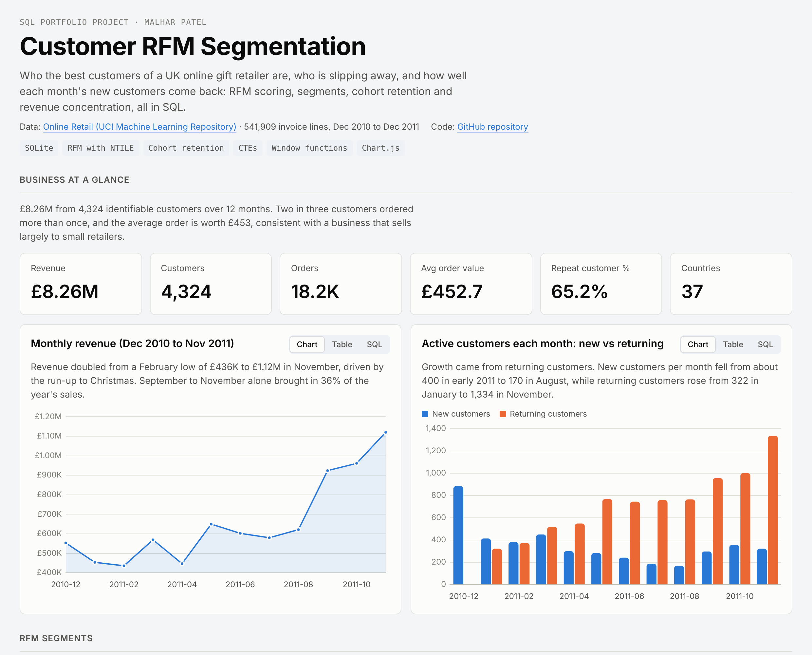
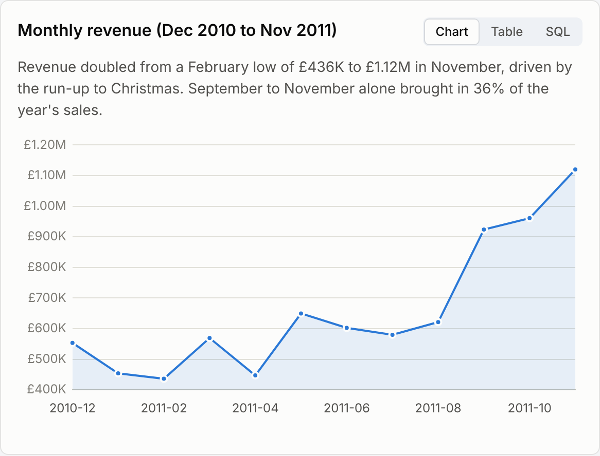
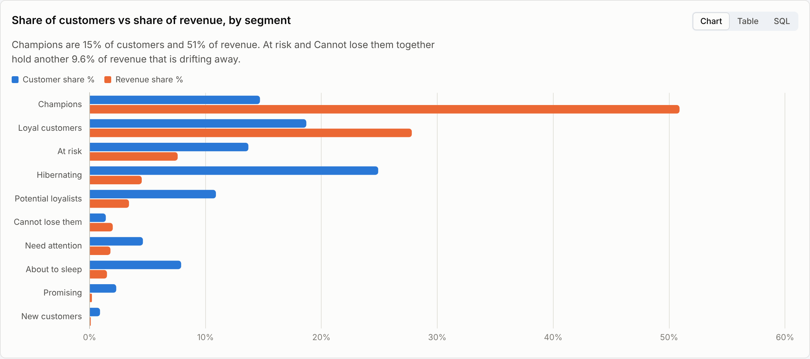
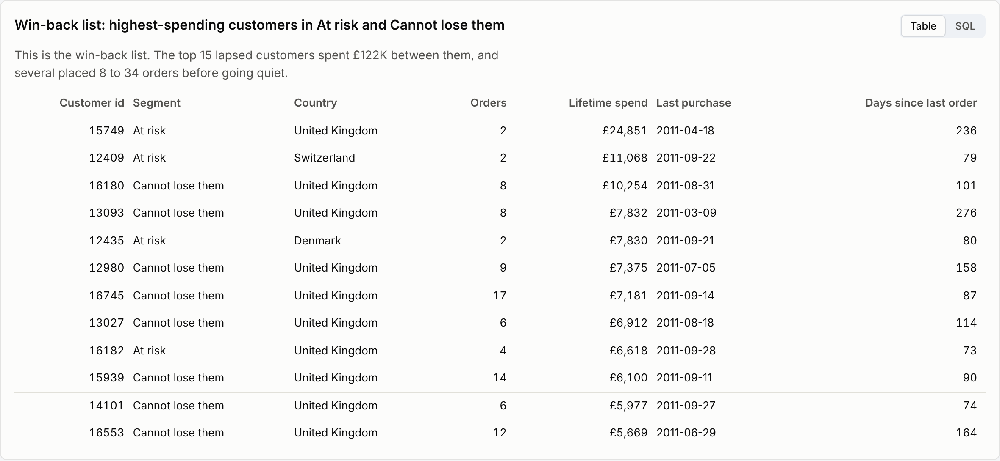
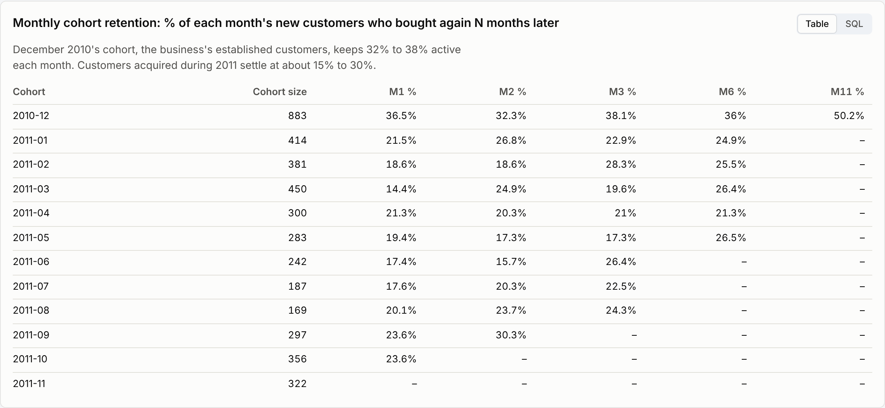

# Customer RFM Segmentation (SQL)

Who the best customers of a UK online gift retailer are, who is slipping away, and how well each month's new customers come back. RFM scoring, customer segments, cohort retention and revenue concentration, built entirely in SQLite from 541,909 raw invoice lines, with an interactive dashboard.

**[Open the live dashboard](https://malharpatel78.github.io/customer-rfm-segmentation-sql/)**  ·  every chart has a SQL tab showing the exact query behind it.



## Business questions

1. How is revenue trending, and is growth coming from new or returning customers?
2. Which customers are the most valuable, and which valuable customers are at risk of leaving?
3. How concentrated is revenue across the customer base?
4. What share of new customers buys again, and how quickly?
5. Who should the marketing team contact first in a win-back campaign?

## Dataset

[Online Retail](https://archive.ics.uci.edu/dataset/352/online+retail) from the UCI Machine Learning Repository: every transaction of a UK-based online retailer of gifts and homeware between 1 December 2010 and 9 December 2011. 541,909 invoice lines with invoice number, product, quantity, unit price, timestamp, customer id and country. Many customers are small retailers buying in bulk. The raw file is in `data/online_retail.csv`.

## Data cleaning

`sql/01_clean.sql` logs every fix in a `data_quality_log` table:

| Issue found | Rows | Fix |
|---|---:|---|
| No customer id (guest checkout) | 135,080 | Excluded: cannot be tied to a customer |
| Cancellation invoices (number starts with `C`) | 9,288 | Excluded |
| Zero or negative quantity or price | 11,805 | Excluded |
| Postage, bank charges, fees, manual adjustments, vouchers | 2,950 | Excluded |
| Exact duplicate lines | 5,268 | Kept one copy |
| Sales later reversed by a matching cancellation | 3,920 | Excluded |
| Dates stored as `M/D/YYYY H:MM` text, which sorts wrongly | all | Rebuilt as ISO `YYYY-MM-DD HH:MM` with string functions |

The reversed-sales step is the one most analyses of this dataset miss. Dropping the `C` invoices removes the refund but leaves the original order in place. The largest line in the file, 80,995 paper birds worth £168K, was cancelled minutes later; without this step it becomes the top product of the year and its buyer one of the top customers.

Result: 387,230 clean sales lines from 4,324 customers in 37 countries.

## Method

`sql/02_rfm_scores.sql` scores every customer from 1 to 5 on each dimension with `NTILE(5)`:

- **Recency:** days from the last order to 10 Dec 2011 (the day after the data ends)
- **Frequency:** number of distinct orders
- **Monetary:** total spend

Because 35% of customers ordered once, many tie on frequency; ties are broken by spend so scores are repeatable. Customers are then assigned to ten segments on the standard recency × frequency grid (Champions, Loyal, Potential loyalists, New, Promising, Need attention, About to sleep, At risk, Cannot lose them, Hibernating).

## Key findings

**1. Revenue doubled into the Christmas season, and returning customers drove it.** Monthly revenue rose from £436K in February to £1.12M in November; September to November brought in 36% of the year. New customers per month fell from about 400 to 170 by August, while returning customers grew from 322 in January to 1,334 in November.



**2. A third of customers bring in four-fifths of revenue.** Champions (15% of customers) generate 51% of revenue and loyal customers (19%) another 28%. The top 20% of spenders account for 74% of revenue.



**3. 9.6% of revenue sits with customers who are drifting away.** The At risk and Cannot lose them segments (652 customers) last ordered about four to five months ago on average. The 15 biggest of them spent £122K, and several placed 8 to 34 orders before going quiet.



**4. Retention is the growth lever.** About a quarter of new customers order again the following month. The December 2010 cohort, the established base, keeps 32% to 38% active each month, while customers acquired in 2011 settle at 15% to 30%.



**5. The second order happens fast or not at all.** A third of repeat customers return within 30 days and two thirds within 90 days; after 180 days a second order becomes unlikely.

## Recommendations

- **Run a win-back campaign now** on the At risk and Cannot lose them segments, starting with the 15-customer list above. Personal outreach is affordable at this size and the accounts are worth up to £25K each.
- **Make the first 30 days count.** Most second orders happen within a month, so a post-purchase sequence (reorder reminder, bestsellers, a time-limited offer) should run in that window.
- **Protect Champions** with priority stock on Christmas lines and early access, since half of revenue depends on 635 customers.
- **Re-engage hibernating one-time buyers cheaply** (email only); they are a quarter of the base but 4.5% of revenue.

## SQL techniques used

| Technique | Where |
|---|---|
| `NTILE(5)` scoring with deterministic tie-breaks | `02_rfm_scores.sql` |
| Rule-based segmentation with `CASE` | `02_rfm_scores.sql` |
| Cohort analysis with month offsets and conditional aggregation | `cohort_retention`, `retention_curve` |
| Self-join on `ROW_NUMBER()` to find each customer's second order | `second_purchase` |
| Anti-join to remove reversed orders | `01_clean.sql` |
| Date parsing from text with `INSTR`, `SUBSTR`, `PRINTF`; `JULIANDAY` and `DATE` arithmetic | `01_clean.sql` |
| Share of total with `SUM(SUM(x)) OVER ()` | segment and quintile queries |

## Repository structure

```
data/online_retail.csv     raw UCI file
sql/01_clean.sql           profiling, cleaning, reversed orders, customers table
sql/02_rfm_scores.sql      R, F, M scores and segments
sql/03_analysis.sql        14 analysis queries, each tagged with a title and insight
results/*.csv              output of every query
docs/index.html            interactive dashboard (GitHub Pages)
scripts/build.py           loads the CSV into SQLite, runs the SQL, builds the dashboard
images/                    dashboard screenshots used in this README
```

## How to run

```bash
pip install pandas
python scripts/build.py      # creates data/retail.db, results/, docs/index.html (about 10 seconds)
```

Or in DB Browser for SQLite: import `data/online_retail.csv` as `retail_raw`, then run the three SQL files in order.

## Resume line

> Segmented 4,324 e-commerce customers with RFM scoring and cohort retention analysis in SQL (NTILE, window functions, cohort pivots) on 541,000 transactions; found Champions (15% of customers) drive 51% of revenue and built a win-back list for at-risk accounts holding 9.6% of revenue.

---
Malhar Patel · MS Marketing Analytics & Insights, Rutgers Business School · [LinkedIn](https://www.linkedin.com/in/malharpatel0911)
